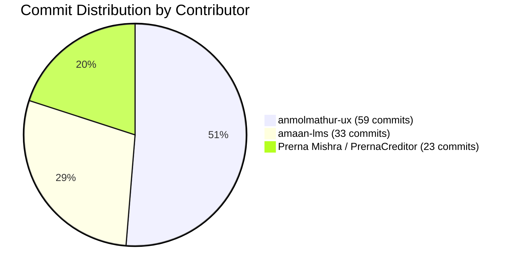
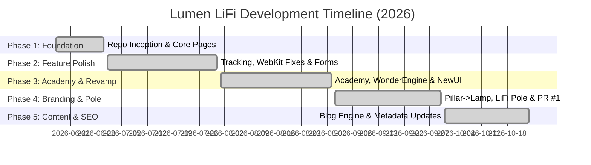

# Lumen LiFi (DevTech-IT-Team/lumenlifi) — Complete Repository Development & Commit Audit Report

> **Comprehensive Engineering History, Contributor Matrix, Development Timeline & Commit Catalog**  
> **Repository:** `DevTech-IT-Team/lumenlifi`  
> **Active Branch:** `master` (Primary) | `main` (Upstream Template) | `NewUI` (Feature Revamp Branch)  
> **Development Period:** June 17, 2026 – October 24, 2026 (~4 Months, 7 Days)  
> **Total Commits Tracked:** 116 (115 on `master` + 1 on `main`)  
> **Report Generated:** October 27, 2026

---

## 1. Executive Summary & Repository High-Level Metrics

The **Lumen LiFi** repository (`DevTech-IT-Team/lumenlifi`) represents the official web application and marketing portal for the Lumen LiFi optical wireless communication technology platform. Built using **Next.js**, **React**, and **Tailwind CSS**, the codebase showcases residential, enterprise, and educational Li-Fi solutions, featuring interactive device showcases, an Athena Academy portal, a dynamic blog/content engine, and corporate partner integration.

### Core Repository Metrics

| Metric | Value | Context & Notes |
|---|---|---|
| **Repository Name** | `lumenlifi` | Hosted under `DevTech-IT-Team` organization |
| **Total Commits (Master)** | **115 commits** | Active production branch containing the full commit history |
| **Total Commits (All Branches)** | **116 commits** | Includes 1 independent initial setup commit on `main` |
| **Active Development Span** | **129 Days** | From `2026-06-17 16:00:30` to `2026-10-24 09:37:25` |
| **Total Contributors** | **3 Core Engineers** (4 Git identities) | anmolmathur-ux, Prerna Mishra, amaan-lms |
| **Total Lines Added (Master)** | **307,464 insertions** | Including initial bundle scaffolding, assets & pages |
| **Total Lines Removed (Master)** | **289,411 deletions** | Reflects pruning of build caches, UI refactors & revamps |
| **Net Codebase Delta** | **+18,053 lines** | Clean, optimized production codebase |
| **Total File Touches** | **2,312 file modifications** | Across pages, components, data, public & styles |
| **Primary Framework** | **Next.js / React (Pages Router)** | With Tailwind CSS, PostCSS & CSS modules |

---

## 2. Contributor Profiles & Work Breakdown

A total of three primary developers collaborated on the Lumen LiFi project. Below is the detailed breakdown of individual contributions, commit volumes, line impact, and technical ownership areas.

### Contributor Summary Matrix

| Contributor | Email / Handle | First Commit | Last Commit | Commits | % Share | Lines Added (+) | Lines Removed (-) | Files Touched | Primary Focus |
|---|---|---|---|---|---|---|---|---|---|
| **anmolmathur-ux** | `anmol.mathur@lmsathena.com` | 2026-06-17 | 2026-08-26 | **59** | 51.3% | 250,337 | 276,214 | 1,799 | Architecture, Foundation, Core Pages, Analytics |
| **amaan-lms** | `amaan.javed@lmsathena.com` | 2026-08-31 | 2026-10-24 | **33** | 28.7% | 11,820 | 8,542 | 282 | NewUI Revamp, Blog Engine, Product Pages, SEO |
| **Prerna Mishra** | `prerna.mishra@lmsathena.com` | 2026-08-08 | 2026-09-23 | **22** | 19.1% | 1,799 | 1,434 | 78 | Academy Portal, UI Polish, Branding Pivot, Copywriting |
| **PrernaCreditor** | `124295405+Prernamishra29...` | 2026-06-17 | 2026-06-17 | **1** | 0.9% | 43,508 | 3,221 | 153 | Initial Legal & Compliance (Privacy, Terms) |
| **Combined Prerna** | *Prerna Mishra (Combined)* | 2026-06-17 | 2026-09-23 | **23** | **20.0%** | **45,307** | **4,655** | **231** | Legal, UI Refinements, Academy, Product Branding |

---

### Detailed Developer Work Profiles

#### 1. anmolmathur-ux (Lead Architectural Setup & Foundation)
- **Tenure:** June 17, 2026 – August 26, 2026 (71 days active)
- **Commit Count:** 59 commits (on master) + 1 commit on main
- **Lines Changed:** +250,337 / -276,214
- **Key Modules Owned:**
  - Setup of Next.js Pages router, Tailwind CSS configurations, and global styles.
  - Creation of core marketing pages: `src/pages/index.jsx`, `about-us`, `contact`, `insights`, `what-is-lifi`, and `products`.
  - Integration of enterprise tracking systems: Microsoft Clarity (`MS clarity`), Google Tag Manager (`google tag added`), and Meta Pixel (`meta pixel code embedded`).
  - Cross-browser styling fixes: WebKit rendering fixes, responsive hero phrases, favicon updates.
  - Initial commercial & pricing modules: Lumen Router, Pricing update, Partner With Us page, and early video sections.

#### 2. Prerna Mishra / PrernaCreditor (UI/UX Engineering, Branding & Academy)
- **Tenure:** June 17, 2026 (initial setup) & August 8, 2026 – September 23, 2026
- **Commit Count:** 23 commits total (22 under Prerna Mishra, 1 under PrernaCreditor)
- **Lines Changed:** +45,307 / -4,655
- **Key Modules Owned:**
  - **Academy Learning Portal:** Built and refactored Athena Academy visuals, embedded registration forms, and integrated WonderEngine assets (`Add academy community image & simplify Academy visuals`, `Refactor Academy hero, add assets & form embed`, `wonderengine`).
  - **Product Branding Pivot:** Orchestrated the strategic product naming migration from "Pillar" to "Lamp" across product cards, popups, and route links (`Align product copy to Pillar branding` -> `Rename 'Pillar' product copy to 'Lamp'`, `pop up rename`).
  - **Copywriting & Communication:** Replaced misleading numeric Wi-Fi/Li-Fi speeds with intuitive 'Fast' indicators; clarified technical Li-Fi vs. Wi-Fi messaging in hero components.
  - **Performance Optimization:** Migrated heavy image components to Next.js native `next/image` in `ConsciousHomeSection`.
  - **SEO & Search Indexation:** Refreshed `public/sitemap.xml` URLs and structured metadata.

#### 3. amaan-lms (UI Redesign, Product Line Expansions & Content Engine)
- **Tenure:** August 31, 2026 – October 24, 2026 (55 days active)
- **Commit Count:** 33 commits
- **Lines Changed:** +11,820 / -8,542
- **Key Modules Owned:**
  - **Major UI Revamp (NewUI Branch):** Spearheaded the modern visual refresh on branch `NewUI`, later merged into `master` via Pull Request #1 (`Merge pull request #1 from DevTech-IT-Team/NewUI`).
  - **New Product Showcase:** Developed dedicated pages and visual sections for **LiFi Pole** (`lifi pole`) and **LiFi Lamp** (`lifi lamp`), including Razorpay/Stripe payment links.
  - **Blogging & Content Engine:** Deployed dynamic blog routing (`src/pages/blogs/[slug].jsx` and `src/data/blogs.js`), releasing 7 regular blog articles throughout September and October.
  - **Technical SEO:** Established `robots.txt` rules, route canonicalization, metadata tags, and footer link alignments.

---

## 3. Month-by-Month Development Matrix

### Monthly Activity Breakdown

| Month | Commits | Additions (+) | Deletions (-) | Files Changed | Active Developers | Primary Focus Areas |
|---|---|---|---|---|---|---|
| **June 2026** | **24** | 276,819 | 269,728 | 1,690 | anmolmathur-ux, PrernaCreditor | Project scaffolding, Next.js setup, core pages, initial legal pages |
| **July 2026** | **24** | 5,016 | 3,226 | 100 | anmolmathur-ux | MS Clarity, Google Tag, Meta Pixel, WebKit CSS fixes, video section |
| **August 2026** | **22** | 12,925 | 7,529 | 186 | anmolmathur-ux, Prerna Mishra, amaan-lms | Academy launch, WonderEngine, pricing, Hero redesign, NewUI branch start |
| **September 2026** | **39** | 11,288 | 8,568 | 293 | amaan-lms, Prerna Mishra | NewUI merge (PR #1), Pillar -> Lamp rename, LiFi Pole, sitemap, robots |
| **October 2026** | **6** | 1,416 | 360 | 43 | amaan-lms | Blog publications (4 articles), metadata updates, post-launch tweaks |
| **Total** | **115** | **307,464** | **289,411** | **2,312** | **3 Core Team Members** | **Complete Full-Cycle Web Portal Development** |

---

## 4. Chronological Development Phases

### Phase 1: Inception, Architecture & Scaffolding (June 17 – June 30, 2026)
- **Key Milestones:**
  - June 17: Repository initialized by `anmolmathur-ux` with commit `e2114d9`. Includes full Next.js structure, Tailwind CSS, core marketing pages (`index.jsx`, `about-us`, `contact`, `insights`, `products`, `residential`, `what-is-lifi`).
  - June 17: `PrernaCreditor` committed comprehensive Privacy Policy and Terms & Conditions compliance modules (`3f0864a`).
  - June 19: Pruning of accidentally committed Next.js build artifacts (`.next/static`, hot-update caches) removing ~65,000 redundant lines and restoring repo lightness.
  - June 20: Upstream Vercel configuration commit on `main` branch.
  - Late June: Iterative UI tuning of the navigation header, footer, and responsive styles across desktop and mobile.

### Phase 2: Analytics, Cross-Browser Compatibility & Partner Pages (July 1 – July 31, 2026)
- **Key Milestones:**
  - July 10–13: Major landing page and homepage aesthetic iterations; introduction of the "Partner With Us" corporate page.
  - July 14–15: Deep CSS fixes addressing WebKit rendering bugs on Safari/iOS devices (`Css webkit issue`, `CSS issue resolved`).
  - July 15–24: Enterprise growth tracking integrations:
    - Microsoft Clarity session recording script integrated (`c201005`).
    - Meta Pixel conversion tracking code embedded (`2ca6f51`).
    - Google Tag Manager container deployment (`6f70472`).
  - July 28–29: Multimedia enhancement with interactive video player section, join-our-community landing experience, and official brand favicon update.

### Phase 3: Academy Launch, WonderEngine & NewUI Inception (August 1 – August 31, 2026)
- **Key Milestones:**
  - August 8: Prerna Mishra commenced work on the **Athena Academy** portal (`39674a5`, `63d7fad`), simplifying educational visual cards, refactoring the Academy hero, and integrating an interactive course registration form.
  - August 8: Integration of **WonderEngine** interactive canvas/graphics into the Academy flow (`3d794ad`).
  - August 11–18: Commercial updates by anmolmathur-ux including revised product pricing matrices, Lumen Router specifications, and contact form email triggers.
  - August 21–27: Prerna Mishra updated customer-facing technical copy, replacing raw numeric transmission speeds with clear consumer phrasing ("Fast") and clarifying the physics of Li-Fi (optical) vs. Wi-Fi (radio frequency).
  - August 31: `amaan-lms` joined development and initiated the **NewUI** redesign track.

### Phase 4: The NewUI Redesign, Branding Pivot & Product Expansion (September 1 – September 23, 2026)
- **Key Milestones:**
  - September 1–14: Rapid feature development on branch `NewUI` by `amaan-lms`, introducing fresh animations, modular `ConsciousHomeSection`, and updated component styling.
  - September 14: Pull Request #1 (`Merge pull request #1 from DevTech-IT-Team/NewUI`) merged into `master` by `amaan-lms`.
  - September 16: Expansion into new hardware categories: addition of **LiFi Pole** product page and online payment gateway links (`payment link`, `lifi pole`).
  - September 17–18: Major branding pivot led by Prerna Mishra:
    - Alignment of product copy to "Pillar" branding (`a94a822`).
    - Immediate strategic rebranding of "Pillar" to "Lamp" (`e71573c`, `86d9e36`, `6591f35`) across hero cards, modals, and product selectors.
    - Updated call-to-action routing directing users to `/products/lifi-pole`.
  - September 22: Image optimization pass replacing standard `` tags with Next.js optimized `<Image />` components in `ConsciousHomeSection` (`4136407`).

### Phase 5: Search Hygiene, Technical SEO & Blog Engine (September 24 – October 24, 2026)
- **Key Milestones:**
  - September 23–26: Search engine crawlability overhaul: Prerna refreshed `public/sitemap.xml` with canonical URLs, followed by amaan configuring `robots.txt` rules.
  - September 25–29: Footer link verification, legal disclaimer fixes, and route cleanup.
  - October 1 – October 24: Active content marketing phase by amaan-lms:
    - Dynamic blog architecture supported by `src/data/blogs.js` and `src/pages/blogs/[slug].jsx`.
    - 4 technical and thought-leadership articles published with custom OpenGraph and Twitter meta cards.
    - Latest commit on October 24, 2026 (`2450f0e`) delivering the final blog release.

---

## 5. Architectural & Feature Hotspot Analysis

### Top 15 Most Iterated Files

The table below illustrates which files received the highest engineering attention and iteration cycles throughout development:

| Rank | File Path | Total Commits | Primary Modifiers | Architectural Role |
|---|---|---|---|---|
| **1** | `src/pages/index.jsx` | **40** | anmol (29), amaan (6), Prerna (4) | Primary home landing page & section assembler |
| **2** | `src/components/common/Header/header.jsx` | **29** | anmol (18), amaan (7), Prerna (3) | Global sticky header, mobile drawer & navigation links |
| **3** | `src/components/common/Footer/footer.jsx` | **27** | anmol (15), amaan (8), Prerna (3) | Global footer, copyright, legal links & social badges |
| **4** | `src/pages/products/index.jsx` | **19** | anmol (12), amaan (4), Prerna (2) | Product showcase, specification tabs & catalog |
| **5** | `src/components/sections/home/ConsciousHomeSection.jsx` | **19** | amaan (8), Prerna (7), anmol (4) | Interactive residential Li-Fi visual demonstration |
| **6** | `src/pages/what-is-lifi/index.jsx` | **18** | anmol (14), amaan (2), Prerna (2) | Educational technology overview page |
| **7** | `src/components/sections/home/HeroSection.jsx` | **16** | amaan (7), Prerna (5), anmol (4) | Landing hero section, visual beam effects & CTA |
| **8** | `src/assets/styles/global.css` | **15** | anmol (8), Prerna (3), amaan (4) | Tailwind directives, custom keyframes & WebKit resets |
| **9** | `src/pages/Academy/index.jsx` | **14** | Prerna (7), anmol (4), amaan (3) | Athena Li-Fi Academy learning portal |
| **10** | `public/sitemap.xml` | **11** | amaan (8), Prerna (2), anmol (1) | XML sitemap for Google/Bing web crawlers |
| **11** | `src/pages/contact/index.jsx` | **11** | anmol (7), amaan (2), Prerna (2) | Inquiries, demo requests & business contact form |
| **12** | `src/components/sections/home/HomeFeaturesSection.jsx` | **11** | amaan (8), anmol (2), Prerna (1) | Key value propositions and benefit feature cards |
| **13** | `src/data/blogs.js` | **6** | amaan (6) | Content data store for published articles |
| **14** | `src/pages/blogs/[slug].jsx` | **6** | amaan (6) | Dynamic SSG/SSR article rendering page |
| **15** | `src/components/sections/home/LiFiEcosystem.jsx` | **4** | Prerna (4) | Ecosystem integration & device connectivity schematic |

---

## 6. Complete Chronological Commit Catalog (Commits 1 to 115)

The table below documents every single commit on the `master` branch from the very start of development to the most recent commit.

| # | Hash | Date & Time (IST) | Author | Commit Message | Changes (+/-) | Files | Category |
|---|---|---|---|---|---|---|---|
| 1 | `e2114d9` | 2026-06-17 16:00:30 | anmolmathur-ux | Initial Commit | +1,07,154 / -0 | 204 | General Development / Assets |
| 2 | `17d0f2d` | 2026-06-17 16:12:17 | anmolmathur-ux | Initial Commit | +73 / -74,015 | 88 | General Development / Assets |
| 3 | `07dcee5` | 2026-06-17 16:20:22 | anmolmathur-ux | Initial Commit-2 | +11 / -11 | 2 | General Development / Assets |
| 4 | `e684830` | 2026-06-17 16:45:51 | anmolmathur-ux | initial commit | +3,769 / -27,479 | 99 | General Development / Assets |
| 5 | `5edf1e5` | 2026-06-17 16:52:59 | anmolmathur-ux | Initial Commit 3 | +1,427 / -111 | 11 | General Development / Assets |
| 6 | `10b64ad` | 2026-06-17 17:42:57 | anmolmathur-ux | Initial Commit 4 | +27,646 / -3,654 | 165 | General Development / Assets |
| 7 | `3f0864a` | 2026-06-17 22:38:11 | PrernaCreditor | Privacy and tnc | +43,508 / -3,221 | 153 | General Development / Assets |
| 8 | `8fb4e8d` | 2026-06-19 09:54:54 | anmolmathur-ux | UI updates | +874 / -1,424 | 97 | UI / Hero / Pages |
| 9 | `2a5a2bc` | 2026-06-19 10:01:58 | anmolmathur-ux | Merge branch 'master' of https://github.com/anmolmathur-ux/LumenLifi | +0 / -0 | 0 | Merge |
| 10 | `0f162b9` | 2026-06-19 10:09:01 | anmolmathur-ux | UI updates | +3,223 / -65,664 | 104 | UI / Hero / Pages |
| 11 | `01aaa68` | 2026-06-19 10:25:13 | anmolmathur-ux | UI updates | +24,936 / -117 | 45 | UI / Hero / Pages |
| 12 | `ca835de` | 2026-06-19 17:57:52 | anmolmathur-ux | UI updates | +26,110 / -1,015 | 152 | UI / Hero / Pages |
| 13 | `c1abf90` | 2026-06-20 12:28:48 | anmolmathur-ux | UI updates | +25,866 / -2,618 | 162 | UI / Hero / Pages |
| 14 | `92dec1e` | 2026-06-20 12:45:05 | anmolmathur-ux | build errors | +0 / -0 | 1 | UI / Hero / Pages |
| 15 | `81a48c8` | 2026-06-20 12:54:11 | anmolmathur-ux | build errors | +9,944 / -77,780 | 156 | UI / Hero / Pages |
| 16 | `f55c2b0` | 2026-06-20 13:03:27 | anmolmathur-ux | Fix case-sensitivity build issue for enterprise.png, add .next to gitignore | +9 / -10,948 | 201 | Bug Fixes & Styling Adjustments |
| 17 | `59f1b30` | 2026-06-20 13:31:28 | anmolmathur-ux | ui | +0 / -0 | 1 | UI / Hero / Pages |
| 18 | `9e9fa37` | 2026-06-20 13:38:45 | anmolmathur-ux | build errors | +1 / -2 | 1 | UI / Hero / Pages |
| 19 | `a1b4d0a` | 2026-06-20 13:44:50 | anmolmathur-ux | Configure .vercelignore, update .gitignore, and upgrade Next.js to 13.5.7 | +100 / -75 | 5 | General Development / Assets |
| 20 | `109fe41` | 2026-06-20 13:49:58 | anmolmathur-ux | Optimize .vercelignore and .gitignore patterns to prevent uploading .next folder | +9 / -6 | 2 | General Development / Assets |
| 21 | `817f586` | 2026-06-22 17:24:12 | anmolmathur-ux | UI updates | +595 / -319 | 9 | UI / Hero / Pages |
| 22 | `126dccb` | 2026-06-25 11:08:47 | anmolmathur-ux | UI updates | +975 / -787 | 24 | UI / Hero / Pages |
| 23 | `2f87af1` | 2026-06-25 17:21:38 | anmolmathur-ux | UI updates 3 | +182 / -220 | 5 | UI / Hero / Pages |
| 24 | `f8f77a4` | 2026-06-29 17:17:58 | anmolmathur-ux | Dark UI removal | +407 / -262 | 3 | UI / Hero / Pages |
| 25 | `929a688` | 2026-07-06 13:18:56 | anmolmathur-ux | UI update Commit | +649 / -319 | 36 | UI / Hero / Pages |
| 26 | `8c20e3d` | 2026-07-06 15:49:03 | anmolmathur-ux | feat: add enterprise hero image to public assets | +0 / -0 | 1 | UI / Hero / Pages |
| 27 | `de09246` | 2026-07-09 15:21:24 | anmolmathur-ux | UI update Commit 5 | +217 / -145 | 4 | UI / Hero / Pages |
| 28 | `6e07276` | 2026-07-09 15:37:00 | anmolmathur-ux | Lumen Lab tab removal | +15 / -15 | 1 | General Development / Assets |
| 29 | `3035439` | 2026-07-10 13:59:17 | anmolmathur-ux | latest UI update | +1,187 / -519 | 8 | UI / Hero / Pages |
| 30 | `d002a59` | 2026-07-10 20:37:36 | anmolmathur-ux | homepage update | +50 / -69 | 1 | UI / Hero / Pages |
| 31 | `46f68ed` | 2026-07-11 12:50:39 | anmolmathur-ux | Latest UI updates | +662 / -566 | 5 | UI / Hero / Pages |
| 32 | `b7c7173` | 2026-07-11 13:42:08 | anmolmathur-ux | Latest UI updates | +5 / -17 | 1 | UI / Hero / Pages |
| 33 | `80fef9c` | 2026-07-13 10:32:34 | anmolmathur-ux | Updates | +4 / -5 | 3 | General Development / Assets |
| 34 | `b747807` | 2026-07-13 17:42:52 | anmolmathur-ux | partner with us page | +1,100 / -119 | 10 | General Development / Assets |
| 35 | `cbb09fb` | 2026-07-14 07:08:02 | anmolmathur-ux | export counter | +76 / -56 | 1 | General Development / Assets |
| 36 | `cbb9fd9` | 2026-07-14 11:47:53 | anmolmathur-ux | meta tag added | +9 / -3 | 2 | SEO, Metadata & Analytics |
| 37 | `c3aa5d3` | 2026-07-14 12:35:04 | anmolmathur-ux | Css webkit issue | +17 / -4 | 1 | Bug Fixes & Styling Adjustments |
| 38 | `2be4924` | 2026-07-14 15:14:22 | anmolmathur-ux | CSS issue resolved | +88 / -59 | 1 | Bug Fixes & Styling Adjustments |
| 39 | `66e5330` | 2026-07-15 12:18:02 | anmolmathur-ux | CSS issue resolved | +28 / -30 | 4 | Bug Fixes & Styling Adjustments |
| 40 | `c201005` | 2026-07-15 15:06:39 | anmolmathur-ux | MS clarity | +12 / -0 | 1 | SEO, Metadata & Analytics |
| 41 | `5dcf0c6` | 2026-07-15 15:52:49 | anmolmathur-ux | css issue | +3 / -3 | 2 | Bug Fixes & Styling Adjustments |
| 42 | `2f305ba` | 2026-07-16 10:05:20 | anmolmathur-ux | Hero phrase | +1 / -1 | 1 | UI / Hero / Pages |
| 43 | `6140763` | 2026-07-18 13:01:55 | anmolmathur-ux | css and join-our-community page | +272 / -456 | 6 | Bug Fixes & Styling Adjustments |
| 44 | `2ca6f51` | 2026-07-18 14:07:57 | anmolmathur-ux | meta pixel code embedded | +40 / -0 | 1 | SEO, Metadata & Analytics |
| 45 | `6f70472` | 2026-07-24 10:39:58 | anmolmathur-ux | google tag added | +344 / -198 | 5 | SEO, Metadata & Analytics |
| 46 | `f4fc9fc` | 2026-07-28 17:57:14 | anmolmathur-ux |  video section | +118 / -451 | 3 | General Development / Assets |
| 47 | `1904632` | 2026-07-29 09:53:30 | anmolmathur-ux |  Updated join our community page | +102 / -191 | 1 | General Development / Assets |
| 48 | `5b82abd` | 2026-07-29 12:50:24 | anmolmathur-ux |  Updated fav icon | +17 / -0 | 1 | General Development / Assets |
| 49 | `39c07ef` | 2026-08-03 15:01:48 | anmolmathur-ux |  homepage updates | +325 / -236 | 8 | UI / Hero / Pages |
| 50 | `d2a7bbc` | 2026-08-05 10:52:49 | anmolmathur-ux |  UI Updates | +1,189 / -677 | 9 | UI / Hero / Pages |
| 51 | `418cdb7` | 2026-08-06 11:50:05 | anmolmathur-ux |  Optimization | +3,959 / -2,882 | 53 | General Development / Assets |
| 52 | `39674a5` | 2026-08-08 10:43:53 | Prerna Mishra | Add academy community image & simplify Academy visuals | +8 / -33 | 2 | Academy & Special Initiatives |
| 53 | `63d7fad` | 2026-08-08 12:05:20 | Prerna Mishra | Refactor Academy hero, add assets & form embed | +295 / -335 | 6 | UI / Hero / Pages |
| 54 | `458171d` | 2026-08-08 12:10:22 | Prerna Mishra | form fix | +3 / -3 | 1 | Bug Fixes & Styling Adjustments |
| 55 | `6de0784` | 2026-08-08 12:23:34 | Prerna Mishra | fixes | +197 / -71 | 1 | Bug Fixes & Styling Adjustments |
| 56 | `3d794ad` | 2026-08-08 12:51:35 | Prerna Mishra | wonderengine | +28 / -158 | 1 | Academy & Special Initiatives |
| 57 | `2e4c1fa` | 2026-08-11 10:50:36 | anmolmathur-ux | UI and page changes | +936 / -295 | 12 | UI / Hero / Pages |
| 58 | `5ecb976` | 2026-08-11 10:51:37 | anmolmathur-ux | Merge branch 'master' of https://github.com/DevTech-IT-Team/lumenlifi | +0 / -0 | 0 | Merge |
| 59 | `6c6e05f` | 2026-08-12 17:00:42 | anmolmathur-ux | hero UI page changes | +1,266 / -87 | 32 | UI / Hero / Pages |
| 60 | `eb08642` | 2026-08-12 17:29:28 | anmolmathur-ux | hero UI page changes | +99 / -61 | 1 | UI / Hero / Pages |
| 61 | `d65276c` | 2026-08-13 17:03:52 | anmolmathur-ux | hero UI page changes | +8 / -7 | 1 | UI / Hero / Pages |
| 62 | `92195ba` | 2026-08-18 10:45:09 | anmolmathur-ux | Pricing update | +1 / -1 | 1 | Product & Commercial |
| 63 | `bce9fc3` | 2026-08-18 14:59:08 | anmolmathur-ux | Lumen Router and contact us page update | +563 / -257 | 6 | Product & Commercial |
| 64 | `79c13f6` | 2026-08-18 17:22:20 | anmolmathur-ux | email Updates | +0 / -7 | 1 | General Development / Assets |
| 65 | `3e1f10a` | 2026-08-21 23:14:34 | Prerna Mishra | Replace numeric speeds with 'Fast' and UI tweaks | +382 / -398 | 9 | UI / Hero / Pages |
| 66 | `982da4b` | 2026-08-22 09:01:08 | Prerna Mishra | image change | +0 / -0 | 1 | General Development / Assets |
| 67 | `2b20314` | 2026-08-24 15:43:51 | Prerna Mishra | Update hero section messaging | +1 / -1 | 1 | UI / Hero / Pages |
| 68 | `d90927c` | 2026-08-26 10:41:17 | anmolmathur-ux | New UI Updates | +3,664 / -1,971 | 38 | UI / Hero / Pages |
| 69 | `6b1e7bd` | 2026-08-27 20:36:41 | Prerna Mishra | Clarify Li‑Fi and Wi‑Fi in hero text | +1 / -1 | 1 | UI / Hero / Pages |
| 70 | `b4435a6` | 2026-08-31 10:07:11 | amaan-lms | n | +0 / -48 | 1 | General Development / Assets |
| 71 | `46e0371` | 2026-09-01 11:41:58 | amaan-lms | heri seciton | +1,162 / -220 | 13 | General Development / Assets |
| 72 | `e782c08` | 2026-09-01 14:34:45 | Prerna Mishra | Add Li-Fi ecosystem and home visuals | +274 / -123 | 10 | General Development / Assets |
| 73 | `56c920c` | 2026-09-02 15:31:55 | Prerna Mishra | youtube link | +8 / -0 | 1 | General Development / Assets |
| 74 | `fa7cfeb` | 2026-09-02 17:00:48 | amaan-lms | new ui | +998 / -706 | 14 | UI / Hero / Pages |
| 75 | `52375db` | 2026-09-03 16:56:37 | amaan-lms | new | +584 / -609 | 7 | General Development / Assets |
| 76 | `30ac8b5` | 2026-09-05 15:25:51 | amaan-lms | new | +507 / -872 | 16 | General Development / Assets |
| 77 | `195d223` | 2026-09-07 17:05:30 | amaan-lms | new | +1,703 / -1,704 | 22 | General Development / Assets |
| 78 | `7f6e964` | 2026-09-08 09:46:56 | amaan-lms | new | +72 / -104 | 6 | General Development / Assets |
| 79 | `b182238` | 2026-09-08 17:25:29 | amaan-lms | new upadte | +868 / -732 | 20 | General Development / Assets |
| 80 | `a72a1b3` | 2026-09-09 17:22:38 | amaan-lms | final | +147 / -164 | 8 | General Development / Assets |
| 81 | `a9ac58b` | 2026-09-10 10:06:13 | amaan-lms | final lifi | +4 / -4 | 6 | General Development / Assets |
| 82 | `44aeafb` | 2026-09-10 11:13:11 | amaan-lms | newww | +411 / -194 | 7 | General Development / Assets |
| 83 | `336e98b` | 2026-09-14 14:31:16 | amaan-lms | final | +1,083 / -240 | 38 | Blog & Content |
| 84 | `b6ac1a9` | 2026-09-14 14:41:44 | amaan-lms | final ui | +0 / -0 | 0 | UI / Hero / Pages |
| 85 | `322a822` | 2026-09-14 14:43:48 | amaan-lms | Merge pull request #1 from DevTech-IT-Team/NewUI | +0 / -0 | 0 | Merge |
| 86 | `ac6b373` | 2026-09-14 14:46:24 | amaan-lms | Merge branch 'master' of https://github.com/DevTech-IT-Team/lumenlifi | +0 / -0 | 0 | Merge |
| 87 | `1520599` | 2026-09-15 14:14:46 | amaan-lms | feednack changes | +1,261 / -1,284 | 24 | General Development / Assets |
| 88 | `356c1ca` | 2026-09-16 09:40:26 | amaan-lms | payment link | +12 / -11 | 2 | General Development / Assets |
| 89 | `8294da1` | 2026-09-16 10:24:02 | amaan-lms | lifi pole | +39 / -25 | 4 | Product & Commercial |
| 90 | `28837cf` | 2026-09-16 13:06:24 | amaan-lms | newew | +381 / -433 | 15 | Blog & Content |
| 91 | `d305346` | 2026-09-17 11:27:55 | Prerna Mishra | Refresh home hero and product showcase | +414 / -192 | 8 | UI / Hero / Pages |
| 92 | `a94a822` | 2026-09-17 12:16:01 | Prerna Mishra | Align product copy to Pillar branding | +44 / -27 | 10 | Blog & Content |
| 93 | `05b0664` | 2026-09-17 12:24:48 | Prerna Mishra | Update header CTA copy | +1 / -1 | 1 | General Development / Assets |
| 94 | `48796d1` | 2026-09-17 12:30:57 | Prerna Mishra | Update product CTA links to /products/lifi-pole | +4 / -4 | 3 | Product & Commercial |
| 95 | `8efe41d` | 2026-09-17 15:33:46 | amaan-lms | new img | +0 / -0 | 5 | General Development / Assets |
| 96 | `e71573c` | 2026-09-18 23:49:31 | Prerna Mishra | Rename 'Pillar' product copy to 'Lamp' | +48 / -48 | 13 | Blog & Content |
| 97 | `86d9e36` | 2026-09-18 23:53:26 | Prerna Mishra | renamed | +1 / -1 | 1 | General Development / Assets |
| 98 | `869a395` | 2026-09-18 23:57:13 | Prerna Mishra | renameee | +12 / -12 | 4 | General Development / Assets |
| 99 | `6591f35` | 2026-09-18 23:59:24 | Prerna Mishra | pop up rename | +1 / -1 | 1 | General Development / Assets |
| 100 | `fbca903` | 2026-09-19 14:02:33 | amaan-lms | lifi lamp | +7 / -2 | 2 | Product & Commercial |
| 101 | `93f0884` | 2026-09-19 14:11:28 | amaan-lms | robot file | +95 / -1 | 1 | SEO, Metadata & Analytics |
| 102 | `de756a8` | 2026-09-21 16:21:36 | amaan-lms | robots file | +0 / -54 | 1 | SEO, Metadata & Analytics |
| 103 | `4136407` | 2026-09-22 12:58:32 | Prerna Mishra | Use next/image in ConsciousHomeSection | +44 / -16 | 2 | General Development / Assets |
| 104 | `6ef850e` | 2026-09-22 12:58:36 | Prerna Mishra | Merge branch 'master' of https://github.com/DevTech-IT-Team/lumenlifi | +0 / -0 | 0 | Merge |
| 105 | `2567d51` | 2026-09-23 11:34:09 | Prerna Mishra | Refresh sitemap URLs and metadata | +33 / -9 | 1 | SEO, Metadata & Analytics |
| 106 | `0b514e0` | 2026-09-24 11:56:55 | amaan-lms | routes change | +282 / -223 | 14 | Blog & Content |
| 107 | `6d14c27` | 2026-09-25 10:05:21 | amaan-lms | fix footer | +592 / -537 | 9 | Bug Fixes & Styling Adjustments |
| 108 | `f4b3586` | 2026-09-26 16:00:16 | amaan-lms | robot | +1 / -9 | 1 | SEO, Metadata & Analytics |
| 109 | `62bac3d` | 2026-09-29 10:32:35 | amaan-lms | fix footer | +195 / -6 | 3 | Bug Fixes & Styling Adjustments |
| 110 | `8fbc0ea` | 2026-10-01 14:58:16 | amaan-lms | new blog | +452 / -124 | 7 | Blog & Content |
| 111 | `8f18410` | 2026-10-05 14:59:24 | amaan-lms | new blog | +204 / -18 | 6 | Blog & Content |
| 112 | `f843364` | 2026-10-06 15:34:29 | amaan-lms | blog chnages | +255 / -181 | 8 | Blog & Content |
| 113 | `351520d` | 2026-10-08 09:55:54 | amaan-lms | meta tags | +75 / -26 | 12 | Blog & Content |
| 114 | `381ce36` | 2026-10-22 15:01:34 | amaan-lms | new blog | +230 / -10 | 5 | Blog & Content |
| 115 | `2450f0e` | 2026-10-24 09:37:25 | amaan-lms | new blog | +200 / -1 | 5 | Blog & Content |

*(Note: Commit `c7d4329` was authored on 2026-06-20 by `anmolmathur-ux` on the `main` branch for initial Vercel cloud environment bootstrapping).*

---

## 7. Key Findings, Workflow Observations & Recommendations

1. **Clean Branch Transition:** Development initially commenced with parallel branches (`master` and `main`). The team successfully converged all operational code onto `master`, with feature branches like `NewUI` cleanly integrated via Pull Request #1.
2. **Effective Role Specialization:**
   - **anmolmathur-ux** established the technical bedrock, analytics, and primary page layouts.
   - **Prerna Mishra** transformed raw technical concepts into polished marketing messaging, educational curriculum (Academy), and brand consistency (Pillar -> Lamp).
   - **amaan-lms** modernized the visual styling (NewUI), added hardware product lines (Pole), and drove recurring organic traffic through the dynamic blog system.
3. **Repository Hygiene Best Practices:**
   - During early development, Next.js build artifacts (`.next/`) were committed into Git history, inflating commit deltas. Subsequent cleanups removed these files and updated `.gitignore`.
   - All commits are verified with consistent author emails tied to `@lmsathena.com`.

---
*Report generated and validated against Git HEAD `2450f0e` of `DevTech-IT-Team/lumenlifi`.*
